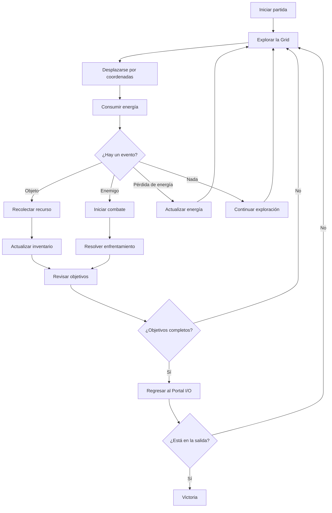

# Diseño del juego — NEXUS V2.0: TRON GRID EDITION

## 1. Visión general

NEXUS V2.0: TRON GRID EDITION es un videojuego de exploración, supervivencia y combate ambientado en un entorno digital futurista. El jugador controla a un usuario que debe explorar diferentes sectores de la Grid, recolectar recursos, enfrentar entidades hostiles y completar objetivos para alcanzar el Portal I/O.

El proyecto parte de la versión H3, desarrollada en C#, que ya contiene una lógica básica de movimiento, exploración, energía, integridad, inventario, enemigos y misiones. La evolución propuesta consiste en conservar estas mecánicas y trasladar su funcionamiento a una interfaz gráfica de escritorio mediante Windows Forms.

### 1.1 Identidad visual

El juego utilizará una estética Cyberpunk avanzada:

- Fondos oscuros para representar el entorno digital.
- Azul eléctrico y violeta como colores principales.
- Paneles holográficos para mostrar información.
- Líneas luminosas para representar los sectores de la Grid.
- Efectos visuales para identificar enemigos, recursos y objetivos.
- Tipografía sencilla y legible, con apariencia tecnológica.

### 1.2 Tipo de juego

- Género: exploración, supervivencia y combate.
- Plataforma: escritorio Windows.
- Tecnología: C# y Windows Forms.
- Base de datos propuesta: Microsoft SQL Server.
- Cámara: vista superior (Top-Down).
- Modo de juego: un jugador.

## 2. Objetivo principal

El jugador debe explorar la Grid, localizar la anomalía situada en las coordenadas (2,2), recuperar el Disco Madre, enfrentarse al Rectificador CLU y regresar al Portal I/O ubicado en (0,0).

Para completar la misión debe administrar correctamente su energía, integridad y objetos disponibles.

La condición de victoria se basa en completar los objetivos de la misión y alcanzar el punto de salida.

## 3. Ciclo principal del juego

El ciclo de juego se organiza en las siguientes etapas:

1. El jugador inicia una nueva partida.
2. Explora los sectores disponibles mediante el movimiento en la cuadrícula.
3. Consume energía al desplazarse.
4. Encuentra objetos, eventos o entidades hostiles.
5. Recolecta y administra los elementos del inventario.
6. Completa los objetivos de la misión.
7. Regresa al Portal I/O.
8. El sistema verifica las condiciones de victoria.

### 3.1 Diagrama del ciclo de juego



Este diagrama representa el flujo general. La implementación gráfica deberá conservar las reglas de la lógica H3 y corregir las inconsistencias detectadas antes de integrar las mecánicas definitivamente.

## 4. Mecánicas y reglas del juego

Las siguientes mecánicas se identificaron en el código de H3.

### 4.1 Movimiento y exploración

La clase `UsuarioGrid` representa al jugador y utiliza coordenadas X/Y para determinar su posición.

Reglas identificadas:

- El jugador se desplaza por sectores de la Grid.
- El límite de exploración es de tres sectores en cada dirección desde el origen.
- La posición inicial y el Portal I/O se encuentran en (0,0).
- Cada desplazamiento consume 4 unidades de energía.
- Durante la exploración pueden aparecer eventos aleatorios.

**Evolución propuesta:** mostrar el mapa mediante una cuadrícula superior, con el jugador representado por un indicador luminoso y los sectores explorados claramente diferenciados.

### 4.2 Sistema de energía e integridad

El código H3 maneja dos valores importantes:

- Energía: se consume al desplazarse y puede recuperarse mediante objetos.
- Integridad: representa la resistencia del jugador.

Valores iniciales identificados:

| Elemento | Valor |
|---|---:|
| Integridad inicial | 100 |
| Protección inicial | 80 |
| Consumo por movimiento | 4 |

La energía y la integridad son sistemas diferentes. En H3, llegar a cero de energía no provoca directamente la derrota; la derrota está relacionada con la pérdida de integridad.

**Evolución propuesta:** representar ambos valores mediante barras de estado en la interfaz gráfica.

### 4.3 Entidades y enfrentamientos

H3 contiene las clases `EntidadRed`, `SondaCentinela` y `RectificadorCLU`.

- `EntidadRed`: clase base para representar entidades de la Grid.
- `SondaCentinela`: representa una entidad de seguridad.
- `RectificadorCLU`: representa un enemigo que puede iniciar enfrentamientos y atacar al jugador.

**Evolución propuesta:** mostrar las entidades en el mapa con indicadores visuales diferentes. Los enfrentamientos se presentarán en un panel de combate, manteniendo las reglas que se definan para cada entidad.

### 4.4 Inventario

Las clases `NodoMemoria` y `SubsistemaMemoria` gestionan los objetos del jugador.

Características identificadas:

- El inventario permite almacenar hasta 8 nodos.
- Existen objetos relacionados con energía, protección, combate y depuración.
- Los objetos pueden utilizarse durante la partida según su funcionalidad.

**Evolución propuesta:** mostrar los objetos en una ventana de inventario con nombre, descripción, cantidad y acción disponible.

### 4.5 Misiones

La clase `DirectivaDirectorio` administra los objetivos de la misión.

Los objetivos identificados están relacionados con:

1. Explorar la Grid.
2. Encontrar la anomalía en (2,2).
3. Recuperar el Disco Madre.
4. Neutralizar al Rectificador CLU.
5. Regresar al Portal I/O en (0,0).

La versión gráfica mostrará el avance de los objetivos mediante una lista de tareas.

**Corrección necesaria:** en H3 se detectó que el indicador relacionado con la eliminación de CLU puede marcarse al derrotar cualquier entidad. La versión final debe verificar específicamente que se haya neutralizado al Rectificador CLU.

## 5. Diseño de pantallas (Wireframes)

Los siguientes bocetos representan la distribución propuesta de los elementos. No son capturas de una interfaz ya implementada.

### 5.1 Pantalla de menú principal

Objetivo: permitir al jugador iniciar una partida o acceder a las opciones principales.

```text
+------------------------------------------------------+
|                                                      |
|                  NEXUS V2.0                          |
|               TRON GRID EDITION                      |
|                                                      |
|            [ FONDO DIGITAL CYBERPUNK ]                |
|                                                      |
|                 [ NUEVA PARTIDA ]                    |
|                                                      |
|                 [ CONTINUAR ]                        |
|                                                      |
|                 [ CONFIGURACIÓN ]                    |
|                                                      |
|                 [ SALIR ]                            |
|                                                      |
|          SYSTEM ONLINE - GRID CONNECTED              |
+------------------------------------------------------+
```

Elementos:

- Logotipo y nombre del videojuego.
- Botón Nueva partida.
- Botón Continuar, habilitado cuando exista una partida guardada.
- Botón Configuración.
- Botón Salir.
- Fondo oscuro con detalles luminosos.

### 5.2 Pantalla de exploración y mapa

Objetivo: permitir el desplazamiento y mostrar la información del jugador durante la exploración.

```text
+------------------------------------------------------+
| NEXUS GRID                         SECTOR: 0,0       |
+------------------------------------------------------+
| ENERGÍA:    [##########]                             |
| INTEGRIDAD: [##########]                             |
| PROTECCIÓN: [########  ]                             |
+------------------------------------------------------+
|                                                      |
|                  MAPA TOP-DOWN                       |
|                                                      |
|       [-3] [-2] [-1] [ 0] [ 1] [ 2] [ 3]            |
|       [-3] [   ] [   ] [   ] [   ] [   ] [   ]       |
|       [-2] [   ] [   ] [   ] [   ] [   ] [   ]       |
|       [-1] [   ] [   ] [   ] [   ] [   ] [   ]       |
|       [ 0] [   ] [   ] [  ] [ P ] [   ] [   ]        |
|       [ 1] [   ] [   ] [   ] [   ] [   ] [   ]       |
|       [ 2] [   ] [   ] [   ] [   ] [ A ] [   ]       |
|       [ 3] [   ] [   ] [   ] [   ] [   ] [   ]       |
|                                                      |
+------------------------------------------------------+
| [NORTE] [SUR] [ESTE] [OESTE]                         |
|                                                      |
| [INVENTARIO] [MISIONES] [GUARDAR]                    |
+------------------------------------------------------+
| MENSAJES DEL SISTEMA:                                |
| Sector explorado. No se detectan amenazas.           |
+------------------------------------------------------+
```

Leyenda:

- `P`: posición del jugador.
- `A`: ubicación de la anomalía.
- Los sectores no explorados se mostrarán ocultos o diferenciados visualmente.
- Los enemigos y recursos tendrán indicadores propios.

La cuadrícula es una representación conceptual de las coordenadas de H3. La interfaz definitiva deberá actualizar la posición del jugador y los eventos según la lógica del juego.

### 5.3 Pantalla de misiones

Objetivo: mostrar las tareas que el jugador debe completar.

```text
+------------------------------------------------------+
|                  DIRECTIVAS DE LA GRID               |
+------------------------------------------------------+
|                                                      |
| OBJETIVOS PRINCIPALES                                |
|                                                      |
| [ ] Explorar los sectores de la Grid                 |
|                                                      |
| [ ] Localizar la anomalía en (2,2)                   |
|                                                      |
| [ ] Recuperar el Disco Madre                         |
|                                                      |
| [ ] Neutralizar al Rectificador CLU                  |
|                                                      |
| [ ] Regresar al Portal I/O (0,0)                     |
|                                                      |
+------------------------------------------------------+
| PROGRESO: 0 / 5                                      |
|                                                      |
|                 [ VOLVER AL MAPA ]                   |
+------------------------------------------------------+
```

Elementos:

- Lista de objetivos.
- Indicador de progreso.
- Estado de cada misión.
- Botón para regresar al mapa.

Los objetivos deberán actualizarse cuando el jugador realice las acciones correspondientes.

### 5.4 Pantalla de inventario y exploradores

Objetivo: permitir revisar y utilizar los objetos almacenados.

```text
+------------------------------------------------------+
|                 SUBSISTEMA DE MEMORIA                |
+------------------------------------------------------+
| CAPACIDAD: 3 / 8 NODOS                               |
+------------------------------------------------------+
|                                                      |
| NODO 01:                                             |
| [ RECARGA DE ENERGÍA ]                               |
| Recupera energía del usuario.                       |
|                                  [ UTILIZAR ]        |
|                                                      |
| NODO 02:                                             |
| [ DISCO DE PROTECCIÓN ]                              |
| Recupera o mejora la protección.                    |
|                                  [ UTILIZAR ]        |
|                                                      |
| NODO 03:                                             |
| [ NODO DE COMBATE ]                                  |
| Objeto relacionado con enfrentamientos.              |
|                                  [ UTILIZAR ]        |
|                                                      |
+------------------------------------------------------+
|                                                      |
|             [ VOLVER A EXPLORACIÓN ]                 |
+------------------------------------------------------+
```

La pantalla deberá mostrar los nodos disponibles, su descripción y las acciones que realmente estén implementadas.

La denominación visual de esta pantalla podrá incluir información del explorador, pero no se propone un sistema de selección de personajes porque no se identificó esa funcionalidad en H3.

## 6. Criterios de experiencia de usuario (UX)

La interfaz debe ser sencilla de entender y permitir que el jugador identifique rápidamente su situación.

Criterios:

1. **Claridad:** los botones deben tener nombres fáciles de comprender.
2. **Consistencia:** las pantallas deben conservar la misma identidad visual.
3. **Visibilidad:** energía, integridad y protección deben permanecer accesibles durante la exploración.
4. **Retroalimentación:** cada movimiento, combate, recolección o uso de objeto debe generar un mensaje.
5. **Prevención de errores:** no permitir acciones que excedan la capacidad del inventario o que no cumplan sus requisitos.
6. **Navegación sencilla:** el jugador debe poder regresar al mapa desde las pantallas secundarias.
7. **Legibilidad:** los textos deben tener contraste suficiente con los fondos oscuros.

## 7. Alcance y restricciones

### 7.1 Funcionalidades existentes en H3

- Movimiento mediante coordenadas X/Y.
- Exploración de sectores.
- Consumo de energía.
- Control de integridad y protección.
- Aparición de eventos aleatorios.
- Entidades y enfrentamientos.
- Inventario con capacidad máxima de 8 nodos.
- Sistema de objetivos.
- Condición de victoria relacionada con el Portal I/O.

### 7.2 Funcionalidades propuestas para NEXUS V2.0

- Interfaz gráfica mediante Windows Forms.
- Mapa superior con cuadrícula visual.
- Paneles de energía, integridad y protección.
- Pantallas de menú, exploración, misiones e inventario.
- Representación gráfica de enemigos, objetos y sectores.
- Guardado y recuperación de partidas mediante SQL Server.
- Integración de la interfaz con las clases y reglas de H3.
- Corrección de inconsistencias detectadas en la lógica de misiones y objetos.

### 7.3 Restricciones técnicas

- El lenguaje principal será C#.
- La interfaz gráfica se desarrollará con Windows Forms.
- La persistencia de datos utilizará SQL Server.
- Se conservará la lógica existente de H3 siempre que sea funcional.
- No se plantea migrar el proyecto a una aplicación web.
- No se contempla desarrollar un motor gráfico independiente.
- Las nuevas funcionalidades deberán incorporarse progresivamente sin perder las mecánicas principales.

## 8. Resultado esperado

NEXUS V2.0 deberá evolucionar desde una simulación de consola hacia un videojuego de escritorio con interfaz gráfica, manteniendo la identidad de TRON GRID EDITION y las mecánicas implementadas en H3.

La versión final permitirá explorar la Grid mediante un mapa superior, administrar recursos, completar misiones, enfrentarse a entidades y guardar el progreso del jugador en SQL Server.

El diseño establece una base para continuar con la documentación de la arquitectura actual, la arquitectura propuesta y el modelo de datos, sin confundir las funcionalidades existentes con las que todavía deben desarrollarse.
