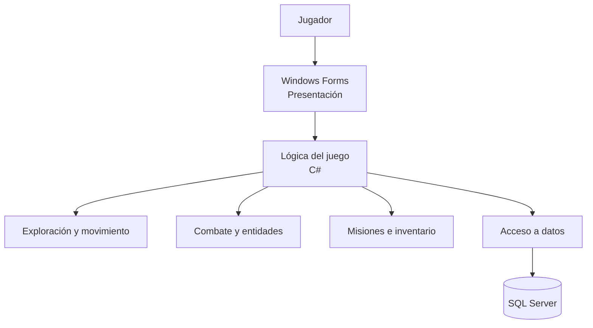

# Arquitectura propuesta — NEXUS V2.0: TRON GRID EDITION

## 1. Introducción

La arquitectura propuesta para NEXUS V2.0 busca transformar el prototipo actual de consola en un videojuego de escritorio con interfaz gráfica Windows Forms y almacenamiento de información mediante SQL Server.

Se conservarán las mecánicas principales desarrolladas en H3, como la exploración, el combate, las misiones y el inventario. La diferencia será la organización del código y la forma en que el jugador interactuará con el sistema.

Esta arquitectura representa el diseño que se propone implementar; no significa que todas sus partes ya estén desarrolladas.

## 2. Objetivo de la arquitectura

Organizar el videojuego en tres partes principales:

1. Interfaz gráfica: permite al jugador utilizar el videojuego mediante ventanas y controles.
2. Lógica del juego: administra las reglas, los personajes, la exploración, el combate y las misiones.
3. Acceso a datos: permite guardar y recuperar el progreso mediante SQL Server.

Esta separación facilitará el mantenimiento y permitirá modificar la interfaz sin tener que cambiar todas las reglas del videojuego.

## 3. Estructura general

La arquitectura tendrá tres capas:

### 3.1. Capa de presentación

Se desarrollará con C# Windows Forms.

Será responsable de mostrar las pantallas y recibir las acciones del jugador.

Pantallas principales previstas:

- Menú principal.
- Pantalla de exploración con mapa de vista superior.
- Panel de misiones.
- Panel de exploradores e inventario.
- Pantalla de combate.
- Pantalla de guardado y carga de partida.

El estilo visual seguirá la temática Cyberpunk elegida para NEXUS, con tonos azules y violetas, elementos holográficos y una cuadrícula digital.

### 3.2. Capa de lógica del juego

Contendrá las reglas y el funcionamiento principal del videojuego.

Se reutilizarán y adaptarán las clases existentes de H3:

- `SistemaTronGrid`: coordinación general de la partida.
- `UsuarioGrid`: información y estado del jugador.
- `EntidadRed`: base de las entidades.
- `SondaCentinela`: enemigo de seguridad.
- `RectificadorCLU`: enemigo principal.
- `NodoMemoria`: objetos del juego.
- `SubsistemaMemoria`: administración del inventario.
- `DirectivaDirectorio`: objetivos y misiones.
- `VisualesTron`: sus funciones de presentación deberán adaptarse para trabajar con la nueva interfaz gráfica.

También se podrán incorporar clases de apoyo para organizar las operaciones de cada sistema. Por ejemplo, servicios para gestionar partidas, misiones y combates.

La lógica no deberá depender directamente de los controles visuales de Windows Forms.

### 3.3. Capa de datos

Se utilizará SQL Server para almacenar la información necesaria para continuar una partida.

Se propone guardar:

- Datos de la partida.
- Estado y ubicación del jugador.
- Energía e integridad.
- Inventario y objetos obtenidos.
- Estado de las misiones.
- Fecha de creación y última actualización del progreso.

Se implementará una clase o componente de acceso a datos para realizar las operaciones de guardar, consultar, actualizar y recuperar partidas.

## 4. Diagrama de arquitectura



El jugador interactúa con Windows Forms. La interfaz envía las acciones a la lógica del juego, que procesa las reglas y solicita al acceso a datos guardar o recuperar la información cuando sea necesario.

## 5. Funcionamiento de una partida

El funcionamiento propuesto será el siguiente:

1. El jugador inicia NEXUS V2.0.
2. El sistema muestra el menú principal.
3. El jugador selecciona iniciar una partida nueva o cargar una existente.
4. Windows Forms solicita a la lógica del juego iniciar o recuperar la partida.
5. La lógica actualiza la exploración, el combate, las misiones y el inventario.
6. Cuando el jugador guarda, el sistema envía el progreso a SQL Server.
7. Al regresar al juego, los datos guardados permiten continuar desde el estado anterior.

## 6. Organización propuesta del proyecto

Se propone organizar el código de la siguiente manera:

```text
ProyectoNexusTron/
│
├── docs/
│   ├── diseno-del-juego.md
│   ├── arquitectura-actual.md
│   └── arquitectura-propuesta.md
│
├── src/
│   ├── NexusGUI/
│   │   ├── Forms/
│   │   ├── Controls/
│   │   └── Program.cs
│   │
│   ├── NexusLogica/
│   │   ├── Entidades/
│   │   ├── Sistemas/
│   │   ├── Misiones/
│   │   └── Servicios/
│   │
│   └── NexusDatos/
│       ├── Conexion/
│       ├── Repositorios/
│       └── Modelos/
│
└── ProyectoNexusTron.sln
```

Esta estructura es una propuesta para organizar el desarrollo futuro. No implica que estas carpetas o proyectos ya existan en el repositorio.

## 7. Comunicación entre las capas

La comunicación seguirá este orden:

- Windows Forms recibe las acciones del jugador.
- La capa de presentación solicita las operaciones a la lógica del juego.
- La lógica procesa las reglas y actualiza el estado de la partida.
- Cuando se necesita guardar o recuperar información, la lógica utiliza la capa de datos.
- La capa de datos se comunica con SQL Server.
- El resultado vuelve a la interfaz para mostrarlo al jugador.

De esta manera, los formularios no tendrán que ejecutar directamente consultas SQL ni contener las reglas del combate o la exploración.

## 8. Guardado y recuperación de partidas

El sistema contará con dos operaciones principales:

**Guardar partida:**

1. Obtener el estado actual del jugador y la partida.
2. Enviar los datos a la capa de acceso a datos.
3. Guardar o actualizar la información en SQL Server.
4. Informar al jugador si el guardado se realizó correctamente.

**Cargar partida:**

1. Consultar las partidas disponibles.
2. Seleccionar la partida que se desea recuperar.
3. Consultar sus datos en SQL Server.
4. Restaurar la ubicación, energía, integridad, inventario y misiones.
5. Mostrar la partida en la interfaz gráfica.

## 9. Ventajas de la propuesta

- Permite utilizar Windows Forms como interfaz principal.
- Aprovecha las clases y mecánicas existentes de H3.
- Separa las ventanas de las reglas del videojuego.
- Facilita la corrección y ampliación de funcionalidades.
- Permite guardar y recuperar el progreso mediante SQL Server.
- Organiza el código para facilitar el trabajo futuro.

## 10. Conclusión

La arquitectura propuesta permitirá que NEXUS evolucione desde su versión de consola hacia un videojuego de escritorio desarrollado en C# Windows Forms.

La lógica de H3 será la base para esta evolución, mientras que la nueva interfaz gráfica permitirá una experiencia visual más completa y SQL Server proporcionará el almacenamiento de las partidas.

La implementación deberá realizarse progresivamente, conectando primero la interfaz con la lógica existente y posteriormente incorporando el sistema de persistencia.
