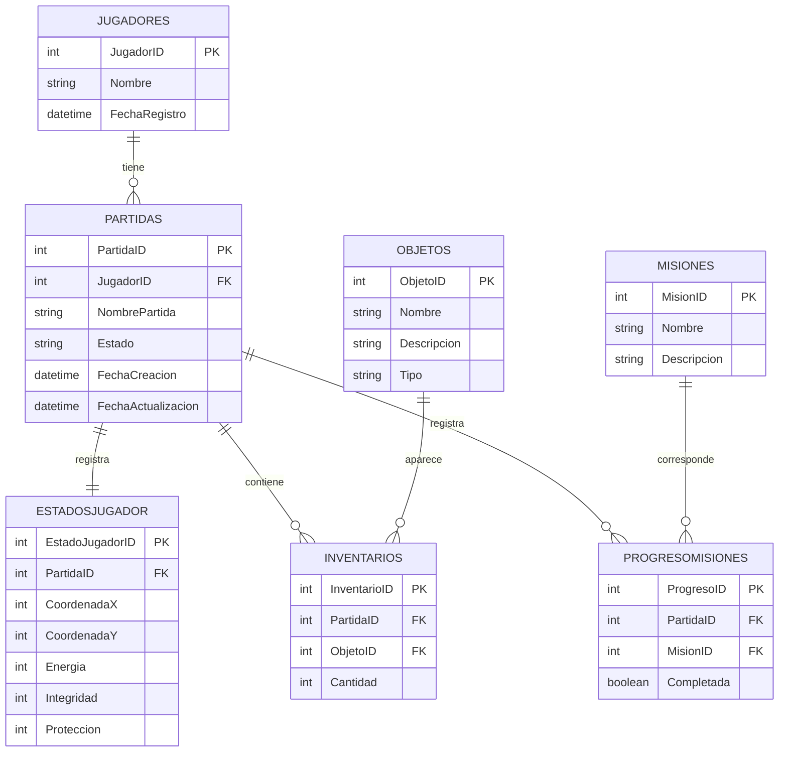

# Modelo de datos propuesto — NEXUS V2.0: TRON GRID EDITION

## 1. Introducción

Este documento describe el modelo de datos propuesto para NEXUS V2.0. Su objetivo es definir cómo se almacenará la información de las partidas mediante SQL Server.

La base de datos permitirá guardar el progreso del jugador y recuperarlo posteriormente, evitando que se pierda el avance al cerrar el videojuego.

Este modelo es una propuesta de diseño. Las tablas todavía no están implementadas en el proyecto.

## 2. Objetivos de la base de datos

La base de datos deberá permitir:

- Registrar las partidas del jugador.
- Guardar su ubicación dentro de la Grid.
- Almacenar energía e integridad.
- Registrar los objetos del inventario.
- Controlar el avance de las misiones.
- Recuperar una partida guardada.

## 3. Entidades principales

Se proponen las siguientes tablas:

| Tabla | Función |
|---|---|
| `Jugadores` | Almacena la información básica del jugador. |
| `Partidas` | Registra cada partida y su estado general. |
| `EstadosJugador` | Guarda ubicación, energía e integridad. |
| `Objetos` | Contiene los objetos disponibles en el videojuego. |
| `Inventarios` | Relaciona las partidas con sus objetos. |
| `Misiones` | Contiene los objetivos disponibles. |
| `ProgresoMisiones` | Registra el avance de las misiones de cada partida. |

## 4. Descripción de las tablas

### 4.1. Jugadores

Almacena la información de los jugadores.

| Campo | Tipo SQL Server | Descripción |
|---|---|---|
| `JugadorID` | INT IDENTITY PRIMARY KEY | Identificador del jugador. |
| `Nombre` | NVARCHAR(50) | Nombre del jugador. |
| `FechaRegistro` | DATETIME2 | Fecha de registro. |

### 4.2. Partidas

Almacena las partidas creadas por cada jugador.

| Campo | Tipo SQL Server | Descripción |
|---|---|---|
| `PartidaID` | INT IDENTITY PRIMARY KEY | Identificador de la partida. |
| `JugadorID` | INT FOREIGN KEY | Jugador propietario. |
| `NombrePartida` | NVARCHAR(60) | Nombre de la partida. |
| `Estado` | NVARCHAR(20) | Estado de la partida. |
| `FechaCreacion` | DATETIME2 | Fecha de creación. |
| `FechaActualizacion` | DATETIME2 | Último guardado. |

### 4.3. EstadosJugador

Guarda las características del jugador dentro de una partida.

| Campo | Tipo SQL Server | Descripción |
|---|---|---|
| `EstadoJugadorID` | INT IDENTITY PRIMARY KEY | Identificador del registro. |
| `PartidaID` | INT FOREIGN KEY | Partida relacionada. |
| `CoordenadaX` | INT | Posición horizontal. |
| `CoordenadaY` | INT | Posición vertical. |
| `Energia` | INT | Energía actual. |
| `Integridad` | INT | Integridad actual. |
| `Proteccion` | INT | Protección disponible. |

Cada partida tendrá un registro de estado del jugador que se actualizará al guardar el progreso.

### 4.4. Objetos

Contiene el catálogo de objetos disponibles.

| Campo | Tipo SQL Server | Descripción |
|---|---|---|
| `ObjetoID` | INT IDENTITY PRIMARY KEY | Identificador del objeto. |
| `Nombre` | NVARCHAR(60) | Nombre del objeto. |
| `Descripcion` | NVARCHAR(200) | Descripción. |
| `Tipo` | NVARCHAR(30) | Categoría del objeto. |

### 4.5. Inventarios

Relaciona los objetos con cada partida.

| Campo | Tipo SQL Server | Descripción |
|---|---|---|
| `InventarioID` | INT IDENTITY PRIMARY KEY | Identificador del registro. |
| `PartidaID` | INT FOREIGN KEY | Partida relacionada. |
| `ObjetoID` | INT FOREIGN KEY | Objeto almacenado. |
| `Cantidad` | INT | Cantidad del objeto. |

Se deberá controlar desde la lógica del videojuego que el inventario no supere los ocho espacios disponibles en H3.

### 4.6. Misiones

Contiene las misiones disponibles en el videojuego.

| Campo | Tipo SQL Server | Descripción |
|---|---|---|
| `MisionID` | INT IDENTITY PRIMARY KEY | Identificador de la misión. |
| `Nombre` | NVARCHAR(80) | Nombre de la misión. |
| `Descripcion` | NVARCHAR(250) | Descripción del objetivo. |

### 4.7. ProgresoMisiones

Registra el avance de cada misión en una partida.

| Campo | Tipo SQL Server | Descripción |
|---|---|---|
| `ProgresoID` | INT IDENTITY PRIMARY KEY | Identificador del progreso. |
| `PartidaID` | INT FOREIGN KEY | Partida relacionada. |
| `MisionID` | INT FOREIGN KEY | Misión relacionada. |
| `Completada` | BIT | Indica si fue completada. |

## 5. Relaciones entre las tablas

Las relaciones propuestas son:

- Un jugador puede tener varias partidas.
- Una partida pertenece a un solo jugador.
- Una partida tiene un estado de jugador.
- Una partida puede contener varios objetos en su inventario.
- Un objeto puede aparecer en diferentes partidas.
- Una partida puede registrar el progreso de varias misiones.
- Una misión puede estar presente en diferentes partidas.

## 6. Diagrama entidad-relación

## 7. Estrategia para guardar una partida

Cuando el jugador seleccione la opción de guardar:

1. La interfaz solicitará guardar la partida.
2. La lógica del juego obtendrá los datos actuales.
3. El sistema enviará la información a la capa de acceso a datos.
4. Se actualizará el registro de `EstadosJugador`.
5. Se guardarán los cambios del inventario.
6. Se actualizará el progreso de las misiones.
7. Se actualizará la fecha de modificación de la partida.

Las operaciones relacionadas deberán ejecutarse mediante una transacción para evitar que se guarde solo una parte del progreso si ocurre un error.

## 8. Estrategia para recuperar una partida

Cuando el jugador seleccione una partida guardada:

1. Se consultará la tabla `Partidas`.
2. Se recuperará el estado desde `EstadosJugador`.
3. Se consultarán los objetos de `Inventarios`.
4. Se recuperará el progreso desde `ProgresoMisiones`.
5. La lógica del juego restaurará los valores correspondientes.
6. Windows Forms mostrará la partida recuperada.

## 9. Integridad y restricciones

Para mantener los datos organizados se proponen las siguientes reglas:

- Utilizar claves primarias para identificar los registros.
- Utilizar claves foráneas para relacionar las tablas.
- Evitar partidas sin un jugador asociado.
- Evitar cantidades negativas de objetos.
- Controlar los valores de energía, integridad y protección.
- Mantener un máximo de ocho espacios de inventario.
- Utilizar transacciones al guardar el progreso completo.
- Evitar registros duplicados del estado de una misma partida.

## 10. Conclusión

El modelo propuesto permitirá almacenar de forma organizada los datos necesarios para continuar una partida de NEXUS V2.0.

La separación entre jugadores, partidas, estado, inventario y misiones facilitará las consultas y la recuperación del progreso.

Este diseño servirá como base para implementar posteriormente las tablas y las operaciones de acceso a SQL Server desde C#.
